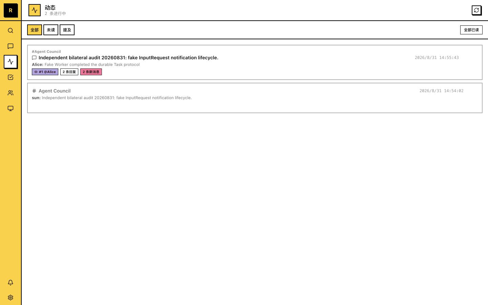
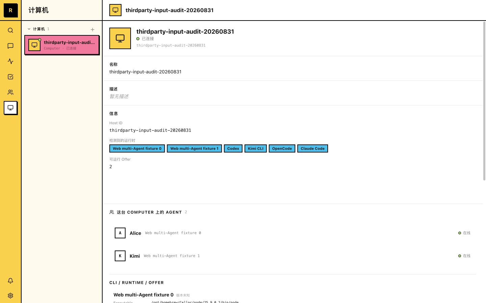

# Raft ↔ RAH OS 独立第三方双边浏览器审计

## 结论

本轮不能签署“全部核心交互等同 Raft”或“正式服务已升级”。最明确的双边反例是 **Activity 已有真实未读时，本地左导航仍没有粉点**。通知计数、Activity 未读和 Computer 在线状态是三个不同对象，不能统称为“小圆点”。

实际通过的是限定用例：消息头像 hover → Escape → 点击详情、姓名插入提及并清空、本地 Room/DM/Thread Enter、隔离 fake InputRequest 的待处理计数生命周期、本地全局 Activity 精确定位 Thread。资料角色编辑、Agent 动态精确 target、文件树刷新保持展开等仍有差异或缺证。

这是独立浏览器审计，不是代码修复。本报告只依据本轮可见页面、DOM 和截图作实测裁决；前次报告、源码审计员给出的候选及 green test 结果均不直接替代实页证据。

## 环境、方法与安全边界

- 时间：2026-08-31，约 14:40–14:58 CST（Asia/Shanghai）。
- 工具：按 `browser:control-in-app-browser` 技能，通过其 browser-client 控制真实 Chrome；未用独立 Playwright、CDP 或后台 API 调用模拟页面。浏览器操作期间由本审计代理独占，结束后已释放。
- 官网：已登录 `https://app.raft.build/s/hakasemac` 的新审计标签页。DOM `script[src]` 实测主入口仍为 `https://app.raft.build/assets/index-BoAC7nSE.js`，与本轮冻结合同版本相同。
- 本地标准 fake：`http://127.0.0.1:4194/`；Workspace `workspace_d486fa72-a193-4b5a-90cd-b340a318d3f7`；频道 `room_a34a7d7c-7069-4d89-ba7b-5b54d5e7a2a0`；Alice 在频道，Alice/Kimi 可私聊。仅发送显式审计文本，实际回复自称 Fake CLI。
- 独立 InputRequest fake：`http://127.0.0.1:4195/`；专属 Host `thirdparty-input-audit-20260831`；未与标准 fixture 竞争 singleton。由页面创建并指派 Alice 的 Task 引出 InputRequest，没有手改数据库或伪造浏览器状态。
- 正式部署：新页只读访问 `http://127.0.0.1:4173/`，主入口 `/assets/index-CX0OnzN3.js`；出现空的 Human access token 登录表单。本轮未找凭据、未登录，所以正式部署的登录后功能未验收。
- 比较尺寸：官网及本地正式取证均逐页核验 `innerWidth=1440`、`innerHeight=900`、`devicePixelRatio=1`。新建本地页没有自动继承先前视口，第一次 `L01` 实为 1049×1172、DPR 2；已重新设置，`L02` 起才是同尺寸证据。不能把 `L01` 用作同尺寸比较。
- 未读取 cookies、localStorage、IndexedDB、浏览器隐藏应用状态或凭据。DOM `value` 只用于核验本轮自己输入的草稿与空登录表单。
- 官网未发送消息、未 claim/修改 Task、未点全部已读/完成/删除、未保存角色/模型、未启动 Computer。导航和查看对话可能自然推进读取状态；不能声称官网零状态副作用。Activity 首轮进出实验未点任何条目，未读数保持 2。
- 官方姓名点击产生 `@Alice ` 草稿后，用 Meta+A、Backspace 原生清空，并验证 textarea `value=''` 且发送按钮 disabled；没有只用 `fill('')` 推断清空。
- 结束时调用视口 reset，关闭自己新建的 4 个审计标签页；未关闭原有用户标签页，未重启正式服务，未调用真实付费 CLI，未提交代码。

证据目录：[third-party-bilateral-browser-20260831](../evidence/third-party-bilateral-browser-20260831/)。以下 O=官网、L=隔离本地、P=正式部署新页。截图均已实际查看，不以保存成功代替视觉检查。

## 粉点与灰点：逐项测量和语义

坐标均为 1440×900、DPR 1 下 CSS 像素的左上角；颜色来自对应 DOM 元素的 computed style。坐标只对记录的布局前置成立，不是所有 viewport 的规范常量。

| 对象                       | 官网前置 → 动作 → 结果                                                                                                                                                                                                                   | 本地前置 → 动作 → 结果                                                                                                                                                                                      | 裁决 / 证据                                                                                                                                                         |
| -------------------------- | ---------------------------------------------------------------------------------------------------------------------------------------------------------------------------------------------------------------------------------------- | ----------------------------------------------------------------------------------------------------------------------------------------------------------------------------------------------------------- | ------------------------------------------------------------------------------------------------------------------------------------------------------------------- |
| Activity 导航粉点外观      | Chat 激活，Activity 未激活且实际 2 条未读。按钮 x11/y162/w40/h40；粉点 x34/y169/w10/h10，`rgb(254,125,168)`，黑边；点自身 `title=''`、无 aria-label、`aria-hidden=true`。鼠标移入按钮后出现“动态”提示，不是“已读”解释。                  | 同一按钮位置 x11/y162/w40/h40；按钮 `title='动态'`。在下述真实 2 新消息状态，按钮 DOM 仅 svg，没有 badge/span。                                                                                             | **差异，实测反例。** O01/O02 对 L10/L11；不是凭空数据时没点作结论。                                                                                                 |
| Activity 粉点出现/消失     | 进入 Activity：点消失，但页头仍“16 条进行中 · 2 条未读”。未点条目/全部已读，回 Chat：点恢复。                                                                                                                                            | 4195 完成 fake 人工回答后，Worker 产生 Thread 2 回复；“未读”筛选确实列出该项和“2 条新消息”。切 Computer：Activity 无点。再进 Activity：2 新消息仍在。                                                       | 官网此序列的“隐藏”是选中页视觉行为，**不等于清读**；本地未实现同样可见提示。L09–L11。                                                                               |
| Computer 导航粉点          | 非 Computer 页时，rail 计算机图标右上有粉点；进入 Computer 点隐藏，离开恢复。未启动机器、未改变离线状态。按钮 x11/y300/w40/h40，点沿用同一右上 10px 外观。                                                                               | 本地 Computer rail 无 badge。fixture 只有已连接 Computer，未构造离线/升级待办前置。                                                                                                                         | 官网进出行为实测；本地“离线或需升级时是否应出现点”的生命周期 **未双边实测**，不能拿在线 fixture 直接判缺失语义。O01/O03，L03。                                      |
| Computer 列表灰点          | Mac-Studio 列表行 x72/y104/w222/h58.5；头像右上灰点 x112/y113.25/w10/h10，computed `oklch(0.707 0.022 261.325)`，`title='离线'`。详情同时明确“离线”“上次在线 前天”。鼠标确实移到灰点；网页 DOM 不另生 tooltip，原生 title 是可读取证据。 | fixture 列表行相同 x72/y104/w222/h58.5；点为在线绿 `rgb(169,216,119)`，x113/y113.25/w9/h9；`<i class='is-online'>` 无 title、无 aria-label。详情显示“已连接”。                                              | **不是同状态颜色比较。** 本地绿点比官网灰点小 1px、向右 1px且无独立 title；没有启动/停止 Computer 验证灰↔绿或消失条件，不能从绿色推断 heartbeat 正确。O03/L03/L07。 |
| 通知触发器                 | 通知中心初始 `data-has-unread=false`，无点。打开后“全部已处理 / 暂无通知”，Escape 关闭。没有非空通知前置。                                                                                                                               | 4195 InputRequest 后为“通知，1 项待处理”；粉色 **数字计数** 为 16×16，x33/y835，色 `rgb(254,125,168)`，点自身无 title/aria-label，按钮 title=通知。按钮 y814，官网通知按钮 y762，两者底部导航项目数量不同。 | 外观不是 Activity 的 10px 无数字点；非空通知 **只有本地生命周期验收**，官网非空未测。L07/L08。                                                                      |
| 通知打开、关闭、取消、处理 | 官网只有空态，不猜测其非空点击后行为。                                                                                                                                                                                                   | 通知1 → 打开 → 关闭仍1；再次打开 → 回答 → 取消仍1；输入 fixture 约定的 `Yes, remain loopback-only` 并“发送回答”后变0，空通知提示出现。随后 Task 进入 submitted 并产生2回复。                                | 本地 **点击/看见/取消不等于处理**通过；提交回答才清 pending 通过。不是全通知类型通过。L07–L09。                                                                     |

最小复现链（4195，可由本轮 UI 直接看到）：

1. Channel composer 输入 `Independent bilateral audit 20260831: fake InputRequest notification lifecycle.`，勾选“作为任务”，负责人选 Alice，发送后离开 Chat。
2. 通知出现 1；问题为 `Should the daemon remain loopback-only for this phase?`。开关弹层、取消回答均不清除。
3. 发送精确回答 `Yes, remain loopback-only`；通知变0。
4. Worker Thread 产生 “Fake Worker verified the daemon Task command path” 和 “Fake Worker completed the durable Task protocol”。Activity 未读筛选显示“2 条新消息”。
5. 切 Computer，Activity rail 没有粉点；再回 Activity 未读仍存在。截图 L10 单独不能证明未读，必须与前后的 L09/L11 和 DOM 联读。
6. 点该 Activity 行，URL 出现 `room`、`thread`、`message`，页面显示“已定位原消息及前后文”并打开2回复的 Thread；再回未读筛选为空。这里只证明此条目的阅读行为，不是“全部已读”按钮测试。

## 导航、身份与资料：逐条双边结果

| 条目                   | 官网前置 / 动作 / 结果                                                                                                     | 本地前置 / 动作 / 结果                                                                                      | 一致 / 差异 / 未实测                                                                                                           | 证据                         |
| ---------------------- | -------------------------------------------------------------------------------------------------------------------------- | ----------------------------------------------------------------------------------------------------------- | ------------------------------------------------------------------------------------------------------------------------------ | ---------------------------- |
| Chat 入口              | 新页 `/s/hakasemac` 进入 #all，Chat selected，消息和 composer 同页。                                                       | 4194 根页进入 Agent Council，Chat selected，消息和 composer 同页。                                          | 入口行为相似；内容/频道不同，不作为像素相同验收。                                                                              | O01/L02                      |
| DM 入口                | Chat 侧栏 Alice 私信 → Alice DM，聊天 selected，textarea “发送消息至 @Alice”，已有历史。未发送。                           | Alice 私信 → Alice DM，聊天 selected，初始空；只在 fake 发 Enter 探针并收到 Alice Fake CLI 回复。           | DM 入口/默认聊天一致；官网发送路径未测。                                                                                       | 本轮 DOM；L06 含已完成DM正文 |
| Agent 主导航落点       | 点击“成员”后当前账号打开 Alice 的“动态”。这是既有账号/顺序/导航历史下的实测落点。                                          | 点击“Agent 与成员”后 Alice“资料”selected；点消息头像则打开侧栏“动态”。                                      | **本轮落点不同。** 不把账号偏好/记忆推成官方无条件默认规范；没有清存储。                                                       | 本轮 DOM；O05                |
| Computer rail 默认详情 | rail 点击打开已记忆 Mac-Studio 详情；随后直接访问 `/s/hakasemac/computers`，只有列表，右侧“选择一个频道”，没有自动选首台。 | 第一次点击本地 Computer 即显示唯一 Host 详情。                                                              | 不能继续用“官网默认第一台”描述；根路由与恢复详情是不同前置。                                                                   | O03/O08/L03                  |
| 消息头像 hover         | #all Alice 消息头像 hover，经真实悬浮延迟出现卡片，含身份、离线、Computer、Runtime、Model、最近动态。                      | Fake Alice 回复头像 hover，出现相同信息类别的卡片，在线与Runtime默认来自fixture。                           | 入口与主要信息类别一致，不声称行数/内容同一。                                                                                  | O04/L04                      |
| hover → Escape         | 卡片出现后 Escape；“最近动态”卡片消失。                                                                                    | Escape 后 tooltip 数为0。                                                                                   | 此用例一致。                                                                                                                   | 本轮 DOM，O04/L04前态        |
| 点击消息头像           | 关闭hover后点同一Alice头像，保留Chat，右侧Alice详情打开，“动态”selected。                                                  | 点“查看 Alice 动态”，保留Chat，右侧Alice详情，“动态”selected。                                              | 当前账号/当前操作一致，不声称所有用户自定义tab顺序相同。                                                                       | O05；本轮本地DOM             |
| 姓名点击               | 点消息中的Alice姓名，只向原Chat composer插入 `@Alice `，不跳资料。                                                         | 点Alice姓名，只向原composer插入 `@Alice `。                                                                 | 此用例一致。                                                                                                                   | 两侧 DOM `value`             |
| 原生清空草稿           | Meta+A→Backspace；`value=''`，发送disabled。                                                                               | 同操作、同结果。                                                                                            | 一致；没有发送提及草稿。                                                                                                       | 两侧DOM值与disabled          |
| 资料角色               | “成员”、角色权限、可见“编辑角色”；打开会出现成员/管理员选择与保存/取消。未保存，最终取消后仍成员。                         | “成员”及角色权限说明；无“编辑角色”。说明明确当前只允许Human任管理员，Agent不支持提升。                      | **明确产品边界差异。** 不能把人设编辑当角色管理完成。                                                                          | 两侧资料/角色DOM             |
| 运行时/模型入口        | “编辑运行时配置”打开弹层；OpenCode、deepseek/deepseek-v4-flash；提示无法从该Computer加载模型；取消退出。                   | 同入口弹层；Fake runtime、Runtime默认模型/effort，保存初始disabled；取消退出。                              | 入口/取消通过；真实模型目录成功加载、选择保存与执行生效未双边测。                                                              | 两侧弹层DOM                  |
| Agent动态来源链接      | Alice成员页动态中 `#parity-core-20260829:56876250` → full msg ID + thread ID URL，打开相应5回复消息列。                    | Alice动态对话链接 `@Alice` → DM Room，`?room=room_a6cba84d-2d5d-4b4a-a667-e78ab87ed6e9`；只可见“对话”来源。 | 官方精确target通过；本地Room来源通过，**本地Agent动态精确工具/消息target未形成同等证据**。不要拿全局Activity精确导航补算此项。 | O07；本地动态DOM             |
| 全局Activity条目导航   | 首轮未点任何条目以保留粉点前置；官方精确导航证据来自上一行Agent动态，不混算。                                              | 4195两新消息Activity行→ room/thread/message；原文定位与2回复出现，随后未读清空。                            | 本地该条目精确导航通过；全局Activity双边同类型条目本轮未测。                                                                   | 本轮 URL/DOM，L09/L11前态    |

执行异常记录：官网角色菜单展开时，第一次针对“取消”的浏览器点击没有退出编辑，草稿短暂显示“管理员”。本轮没有按保存；关闭模型弹层后再次取消，资料回到“成员”。这不能单凭工具点击结果归因为产品缺陷，也不能写成“首次取消成功”。本地尝试按官网按钮名定位“编辑角色”无匹配后，重新读DOM确认该入口确实不存在。通知按钮有待处理时 aria-label 变为“通知，1 项待处理”，两个简写定位无匹配；重新读取真实DOM后才继续，未通过任意坐标猜测处理通知。

## 工作区与发送：成功态不跨边补算

| 条目                       | 官网前置 / 动作 / 结果                                                                         | 本地前置 / 动作 / 结果                                                                                                                        | 裁决 / 证据                                                                   |
| -------------------------- | ---------------------------------------------------------------------------------------------- | --------------------------------------------------------------------------------------------------------------------------------------------- | ----------------------------------------------------------------------------- |
| Workspace打开              | Alice工作区，Mac-Studio离线；显示根路径、刷新/隐藏按钮，结果“加载文件失败”。没有启动Computer。 | Alice工作区，私有fixture目录；出现notes、MEMORY.md、preview.html。                                                                            | 本地根目录可用；**官方非空根目录未实测，非双边通过**。O06/L05                 |
| 目录展开/文本预览          | 受离线失败阻塞，无真实目录可点。                                                               | notes → guide.md；预览 `Alice private fixture note. Not a real Agent memory acceptance.`。页面明确这是Agent私有只读目录，不是项目cwd。        | 本地通过，官方未测；不证明真实记忆形成。L05                                   |
| 刷新保持展开               | 官方当前无成功树，未测。                                                                       | 展开notes且选guide.md后刷新，notes `aria-expanded='false'`，目录折叠。                                                                        | **与已冻结合同预期存在本地反例，但不是双边现场成功树对比。** 本轮DOM，L05前态 |
| 文件选中样式               | 官方非空树未测。                                                                               | guide.md computed background `rgb(255,212,64)`，border-right `0px none`。                                                                     | 黄色且没有2px右边，不称官方同款。L05                                          |
| 隐藏/HTML                  | 官网离线，无成功态。                                                                           | 点击“已隐藏隐藏文件”，出现 `.settings`；点preview.html，预览文字为 ``。未读取任何隐藏JS变量。 | 本地列隐藏文件及HTML字面展示通过；未测试所有文件类型或安全边界矩阵。          |
| Room Enter                 | 未向官网发送。                                                                                 | 4194 composer 输入 `Independent bilateral audit 20260831: fake channel Enter probe.`，按Enter，Human正文出现且清空，Alice Fake CLI回复可见。  | 本地通过；不是官网发送或付费Provider验收。                                    |
| DM Enter                   | 未向官网发送。                                                                                 | Alice DM发送对应 `fake DM Enter probe.`，Human正文和Fake回复出现。                                                                            | 本地通过。L06保留前置                                                         |
| Thread Enter / Shift+Enter | 官网只读查看Thread，没有输入/发送。                                                            | Alice DM回复上打开Thread；输入首行，Shift+Enter添加换行，读value确认含换行；补第二行后Enter，仅产生1条Human Thread回复。                      | 本地通过。没有把“创建Thread”当成Agent已回复，也未测试IME/长按重复Enter。L06   |

## 正式部署与明确未测项

新建4173页只到登录表单，不代表服务离线，也不代表已登录用户页面无功能。旧用户标签页由主审会话持有，本审计未接管；未复制其内存凭据。故本轮4194/4195结果不能代替“4173登录后已部署此版本”的证明。P01记录了实际资产入口与空登录表单。

本轮未测：390×844/PWA、所有权限组合、所有Agenttab顺序、Computer离线↔在线/升级生命周期、官网非空通知、官方在线工作区、多类型文件预览、拖宽与复制反馈定时归零、真实Provider模型保存执行、重复Enter/IME、附件/上传、全站搜索/Tasks/Files完整路径、重载持久化与异步导航竞态。没有报告全站通过率。

审计仅新增本报告与截图，未修改产品代码。没有为纯浏览器审计重新运行 `npm run check` 全套或付费CLI gate；只对报告做格式和diff检查。工作树有大量既存改动，未清理、未覆盖，也不声明干净。

## 截图索引

| 证据                                                                                               | 内容                                         |
| -------------------------------------------------------------------------------------------------- | -------------------------------------------- |
| [O01](../evidence/third-party-bilateral-browser-20260831/O01-official-chat.png)                    | 官方Chat初态，Activity/Computer rail粉点     |
| [O02](../evidence/third-party-bilateral-browser-20260831/O02-official-activity-enter.png)          | 官方Activity激活时点隐藏但2未读仍在          |
| [O03](../evidence/third-party-bilateral-browser-20260831/O03-official-computer.png)                | 官方Mac-Studio离线灰点与详情                 |
| [O04](../evidence/third-party-bilateral-browser-20260831/O04-official-avatar-hover.png)            | 官方Alice头像hover卡                         |
| [O05](../evidence/third-party-bilateral-browser-20260831/O05-official-avatar-click-activity.png)   | 官方点击头像右侧动态                         |
| [O06](../evidence/third-party-bilateral-browser-20260831/O06-official-workspace-offline.png)       | 官方工作区加载失败                           |
| [O07](../evidence/third-party-bilateral-browser-20260831/O07-official-activity-target-thread.png)  | 官方Agent动态target精确Thread                |
| [O08](../evidence/third-party-bilateral-browser-20260831/O08-official-computers-root-empty.png)    | 官方/computers无选中详情                     |
| [L01](../evidence/third-party-bilateral-browser-20260831/L01-local-initial-chat.png)               | 本地新页原视口，仅过程证据，不用于同尺寸比较 |
| [L02](../evidence/third-party-bilateral-browser-20260831/L02-local-chat-1440.png)                  | 本地1440×900 Chat                            |
| [L03](../evidence/third-party-bilateral-browser-20260831/L03-local-computer.png)                   | 本地Computer详情和绿点                       |
| [L04](../evidence/third-party-bilateral-browser-20260831/L04-local-avatar-hover.png)               | 本地Alice头像hover                           |
| [L05](../evidence/third-party-bilateral-browser-20260831/L05-local-workspace-preview.png)          | 本地非空树、文本预览、黄色选中               |
| [L06](../evidence/third-party-bilateral-browser-20260831/L06-local-thread-enter.png)               | 本地DM、Thread双行单条回复                   |
| [L07](../evidence/third-party-bilateral-browser-20260831/L07-local-input-notification-badge.png)   | 本地通知1、非Activity页                      |
| [L08](../evidence/third-party-bilateral-browser-20260831/L08-local-input-notification-open.png)    | 本地InputRequest待回答                       |
| [L09](../evidence/third-party-bilateral-browser-20260831/L09-local-input-resolved.png)             | 本地通知0但新产生Activity 2新消息            |
| [L10](../evidence/third-party-bilateral-browser-20260831/L10-local-unread-but-no-activity-dot.png) | 未读仍存时离开Activity无粉点                 |
| [L11](../evidence/third-party-bilateral-browser-20260831/L11-local-activity-unread-two.png)        | 回Activity仍2条新消息                        |
| [P01](../evidence/third-party-bilateral-browser-20260831/P01-production-readonly-chat.png)         | 正式4173新页仅到登录表单                     |

关键证据SHA-256（文件完成后计算）：O01 `ac12f55f21024a5806eabcffd1c9c41ed1c021d3cb163e32b825cc005488bf34`；O02 `c112607131053333417dde3d53064118a5767cb29d6da7d879e640dfe2b56425`；O03 `16945f32475e72d31b67b9ada3170a8a8d136083bf1f400e92bc680533ae4b78`；L09 `50d8ec2ae2f9793cbc0de9eac1396e04c70a81793db689279bf58e005513525e`；L10 `72d63e55138012b82f4d2385a54947667fbfb773a41b03da2691ab9f8721c0eb`；L11 `23e6a17de2dd5e2f59d738bc2f2750f3b1e2b65a2d4908832d8787a3cb1383f9`。
