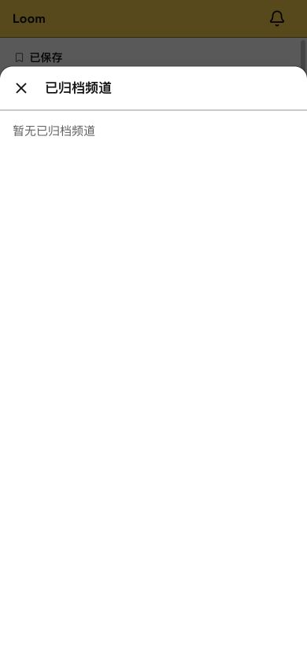

# 移动底色核查及归档面板补验

核查日期：2026-10-27。正式产品仍为 `0f59a16a`，本批没有改产品样式或重启。

## 官方源码结论

当前固定原生源码 `eff04722` 与独立获取的最新候选 `720cd7fc` 比较：
本次列出的颜色、动态、任务、外观与主壳文件字节一致，摘要见 [summary.json](summary.json)。
两版本总体差异集中于消息列分享截图功能；不因此升级整套依赖，也不等同于用户安装的 iOS 发行版。

- `RaftUiColorTokens.g.kt`：浅色 canvas/card/panel 是 `#FFFFFF`；sidebar 是 `#FFFAEF`；frame 是 `#FFD440`。
- `RaftDesignTokens.kt:53/55`：SurfaceWhite 在浅色用 white；SurfaceCream 用 paletteCream。
- `SharedInboxPanel.kt:974`、`SharedTasksPage.kt:180`：内容区域明确使用 SurfaceWhite。
- `SettingsAppearancePage.kt:47`：内容使用 Canvas。
- `SettingsHomePage.kt:15628`：启动恢复画面明确使用 SurfaceCream（暗色使用 Canvas）。
- `SettingsComputersPage.kt:78`：计算机加载占位使用 SurfaceCream；这不证明整个计算机详情都为奶油色。

Loom 正式手机首页的壳测得 canvas 为 `oklch(1 0 0)`，body/root 为
`oklch(0.986 0.0154 86.42)`；官方 Web 0.35.1 依赖也提供相同分层。
**不能根据“似乎浅黄”将所有正文改黄。** 仍需定位用户观察的具体页面、主题与安装版本。
本记录只证明已核查源码和当前浏览器，不能否定用户真机观察。

## 补充验收

390×844 下通过频道列表空白上下文菜单打开“已归档频道”：官方 sheet 标记有效，
高度 759.59375px，显示“暂无已归档频道”，关闭成功；控制台无错误/警告。
未提交归档或恢复。为定位空白菜单临时折叠频道分组，已恢复展开；验收后恢复浏览器视口。
无已归档样本，所以有数据列表及恢复操作仍由既有定向测试覆盖。

没有产品变更，本批不重复跑构建、全仓测试或部署。物理 iOS 验收边界仍保留。
