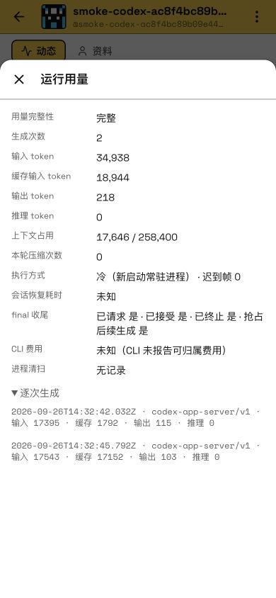

# 移动次级弹窗分类与验收（2026-10-27）

产品提交 `0f59a16a`。沿用官方 `@botiverse/raft-ui@0.35.1` 的
`DialogSheetContent` / `DialogCommit`；原生参考为 botiverse/mobile
`eff04722b5904a0d001115d90d3ec49d59fb4f03` 的 RaftDialogSheet。
这是 Loom 外层组合适配，没有修改官方原件或生成文件。

## 分类

| 场景                                             | 手机容器                           | 本批证据                           |
| ------------------------------------------------ | ---------------------------------- | ---------------------------------- |
| 频道记忆权限                                     | Sheet，多字段，顶部保存关联原 form | source、权限测试、真实页面         |
| 运行用量、逐次生成                               | Sheet，只读，无保存按钮            | source、真实历史记录展开、桌面回归 |
| 新建频道                                         | Sheet，多字段                      | source、真实页面打开/关闭          |
| 已归档频道列表                                   | Sheet，长列表                      | source、归档定向测试               |
| Role 完整编辑                                    | Sheet，多字段                      | source、类型检查                   |
| 单开关任务权限                                   | 普通 Dialog                        | source、真实页面                   |
| 放弃修改、归档确认、删除、恢复角色、单选择器操作 | 普通 Dialog/AlertDialog            | 分类复核；不宣称逐个实机验收       |

共 7 项 source/权限/归档测试与 5 项既有真实 React DOM 测试通过。
DOM 覆盖关联提交、忙碌禁用、桌面 footer、模拟键盘 viewport 和嵌套 picker。
`typecheck:loom`、`build:web:workbench`、格式及 diff 检查通过。
新分类 source 测试实施前失败，实施后通过；没有跑全仓或付费 CLI。

正式服务安全备份后重启：2 个数据库、325 个文件；重启前后 20 项业务表摘要
及推送配置一致。完整回执见 [summary.json](summary.json)。
390×844 浏览器验证记忆权限、新建频道、任务权限和历史运行用量；1440×1000
确认用量恢复为居中 512×554 Dialog，无控制台错误/警告。
没有提交权限或内容修改，没有启动模型；正常浏览可能推进已读位置。

## 边界

归档列表、完整 Role 编辑本批只做 source/type 覆盖。检查的旧频道没有实例成员，
未在浏览器逐项操作成员权限。物理 iOS 键盘、安全区和触屏手势仍需真机验收；
模拟 viewport 不代替真机。本批关闭的是本地次级弹窗分类，不是全站最新版 UI 等价声明。
